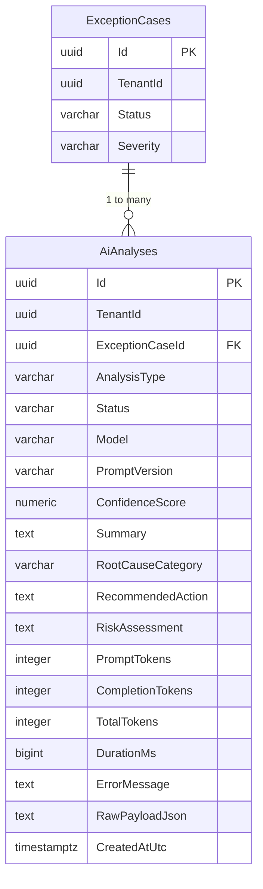

# AI analysis persistence and observability

PP-26 implements the persistence of `AiAnalysis` and execution telemetry for price-variance exceptions.

## Context & Traceability

This slice delivers the data model and observability layer defined in `DM-AI` and backlog task PP-26 (Sprint 6):

- **DM-AI**: Models `AiAnalysis` linked to `ExceptionCase` (`1 -> *`).
- **FR-AI-001**: Tenant isolation enforced at database level and query filters.
- **FR-AI-002**: Evidence references persisted and associated with the analysis.
- **FR-AI-003**: Full traceability of model identifier, prompt version (`2026-10-11.1`), and execution timestamp.
- **FR-AI-004**: Distinct storage of deterministic facts vs. AI interpretation and operational recommendations.
- **FR-AI-005**: Clamped confidence score (`0.0 <= score <= 1.0`) recorded for downstream validation.

## Domain & Persistence Model

### Table Constraints & Indexes

- **Primary key**: `Id`
- **Alternate unique constraint**: `(TenantId, Id)`
- **Foreign key**: `(TenantId, ExceptionCaseId)` references `ExceptionCases(TenantId, Id)` with `ON DELETE CASCADE`.
- **Check constraints**:
  - `CK_AiAnalyses_Status`: `Status IN ('Success', 'Failed', 'Unavailable')`.
  - `CK_AiAnalyses_ConfidenceScore`: `ConfidenceScore IS NULL OR (ConfidenceScore >= 0 AND ConfidenceScore <= 1)`.
  - `CK_AiAnalyses_DurationMs`: `DurationMs >= 0`.
- **Index**: `(TenantId, ExceptionCaseId, CreatedAtUtc)` for low-latency retrieval of the latest analysis and audit history.

## OpenTelemetry Observability

In addition to relational persistence, `AiTelemetry` instruments:
- `ai.analysis.count` (counter tagged by `status`, `model`, `analysis_type`)
- `ai.analysis.duration` (histogram in ms)
- `ai.analysis.tokens.prompt`, `ai.analysis.tokens.completion`, `ai.analysis.tokens.total` (counters)

## Non-Decision Invariant

Per project working rules, persisting an `AiAnalysis` record does not alter the `ExceptionCase.Status` or mutate financial tolerances. AI analysis remains advisory, auditable, and decoupled from deterministic state transitions.

## References

- Backlog task: PP-26 (Persister AiAnalysis et telemetry — Sprint 6)
- Governing ADR: [ADR-AI-006](../adr/ADR-AI-006.md)
