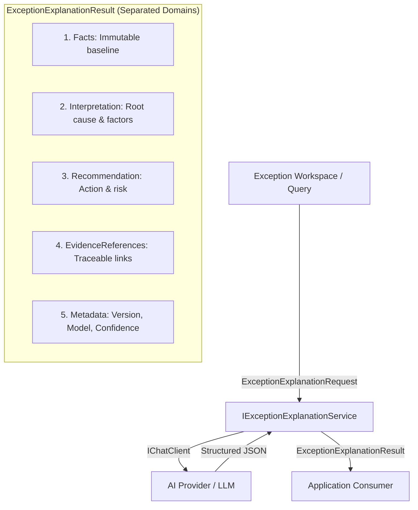

# AI exception explanation service

PP-25 implements the versioned AI prompt and application explanation service for verified price-variance exceptions.

## Context & Requirements Traceability

This service supports human procurement reviewers handling discrepancies detected by deterministic matching rules:

- **FR-AI-001**: Tenant-scoped execution; only data belonging to the current tenant is supplied to the prompt.
- **FR-AI-002**: Evidence references; references verified factual evidence records captured during matching.
- **FR-AI-003**: Traceability; records prompt version (`2026-10-11.1`), model identifier, and generation timestamp.
- **FR-AI-004**: Strict domain separation; separates authoritative facts, AI business interpretation, and operational recommendations.
- **FR-AI-005**: Normalized confidence score; returns an AI confidence assessment between `0.0` and `1.0`.

## Architectural Boundaries

1. **Deterministic Authority**:
   - Financial arithmetic, currency codes, unit prices, line variance percentages, and tolerance thresholds are immutable baseline facts.
   - The AI model is strictly prohibited from recalculating, overriding, or adjusting financial figures.
2. **Non-Decision Policy**:
   - The AI service does not approve or reject invoices, nor does it mutate workflow state transitions on the `ExceptionCase`.
   - The AI service only explains root causes and recommends operational next steps for human buyers or accountants.
3. **Untrusted Data Defense**:
   - Supplier text, item descriptions, and document references are treated as untrusted data.
   - The system prompt instructs the model to ignore any instructions embedded in supplier input to mitigate prompt injection risks.
4. **Provider Neutrality**:
   - Application layer depends solely on `Microsoft.Extensions.AI.IChatClient`.
   - Structured JSON output is enforced via `ChatResponseFormat.ForJsonSchema<ExceptionExplanationResult>`.
   - If the AI chat client is disabled in configuration, the service throws `ExceptionExplanationUnavailableException` with a deterministic, user-friendly diagnostic.

## Contract & Separation of Concerns

### Structured Output Domains

- **`ExceptionExplanationFacts`**: Verified vendor, invoice, purchase order, unit prices, variance percentage, and rule type.
- **`ExceptionExplanationInterpretation`**: Summary of discrepancy, root cause category, and contributing factors.
- **`ExceptionExplanationRecommendation`**: Primary recommended action, suggested operational steps, and business risk assessment.
- **`ExceptionExplanationEvidenceReference`**: Explicit links to evidence captured during matching (`UnitPriceVariance`, `ToleranceRule`).
- **Metadata**: Prompt version (`2026-10-11.1`), model ID, confidence score (`0.0..1.0`), and `GeneratedAtUtc`.

## Scope Boundaries

- **In Scope (PP-25)**: Core application contracts, versioned prompt template, structured JSON schema response, `IChatClient` service implementation, dependency injection registration, and unit tests.
- **Out of Scope (PP-26)**: Exception workspace UI card and human explanation review panel.
- **Out of Scope (PP-27)**: Persistence of explanation records and AI audit table in PostgreSQL.
- **Out of Scope (PP-28+)**: Exception resolution, overrides, and credit-note automation.
