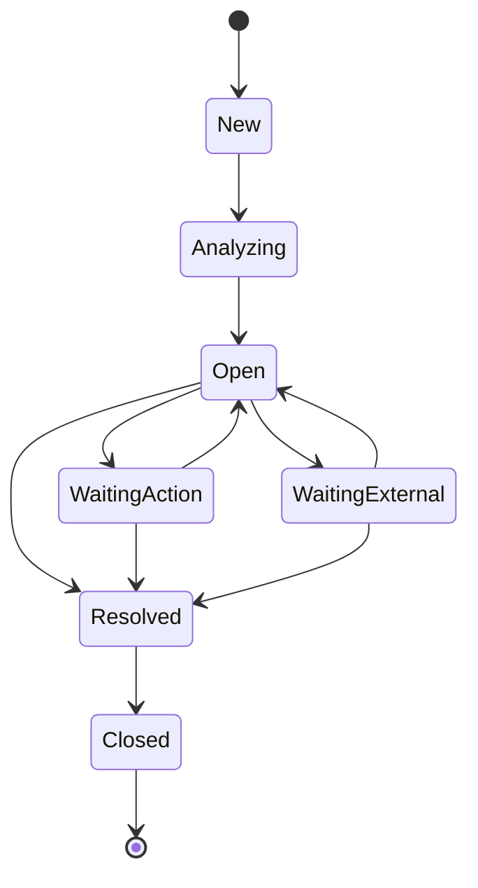

# Exception case state machine

## Aggregate boundary — PP-17

`ExceptionCase` is a tenant-scoped workflow aggregate created from a deterministic failed `MatchResult`. It stores direct references to the related invoice, purchase order, and match result, plus the exception type and UTC lifecycle timestamps. Creation rejects passed results, mismatched evaluated lines, cross-tenant inputs, and timestamps earlier than the source evaluation.

PP-18 adds the application orchestration through `IPriceVarianceMatchingService`: the service loads tenant-filtered inputs, evaluates and persists the deterministic `MatchResult`, and creates the linked `ExceptionCase` in the same database unit of work only when the result fails. A passed result persists without an exception. The unique `(TenantId, MatchResultId)` index remains the database guard against duplicate cases.

PP-20 adds mandatory `ExceptionSeverity` and optional tenant-safe `AssignedToUserId`. The initial `PRICE_VARIANCE` severity is supplied by validated application configuration; age remains derived from `OpenedAtUtc`. The assignment field supports read-side queue filtering only, while the full assignment workflow remains P1.

## Allowed transitions

All other transitions fail without mutating the aggregate. Entering `Resolved` records `ResolvedAtUtc`; `Closed` is terminal. Arithmetic, authorization, and future resolution actions remain outside this state transition method.

When deterministic price matching fails, PP-31's matching orchestration creates the case with its four typed evidence references, then advances it through `New → Analyzing → Open` before the same database save. This is initial workflow preparation, not an AI decision or financial approval. A newly matched case is therefore immediately actionable in the open work queue; human override still requires its separate permission, reason, resolution and audit event. Cases created by other workflows retain their explicit initial `New` state until that workflow defines its own progression.
