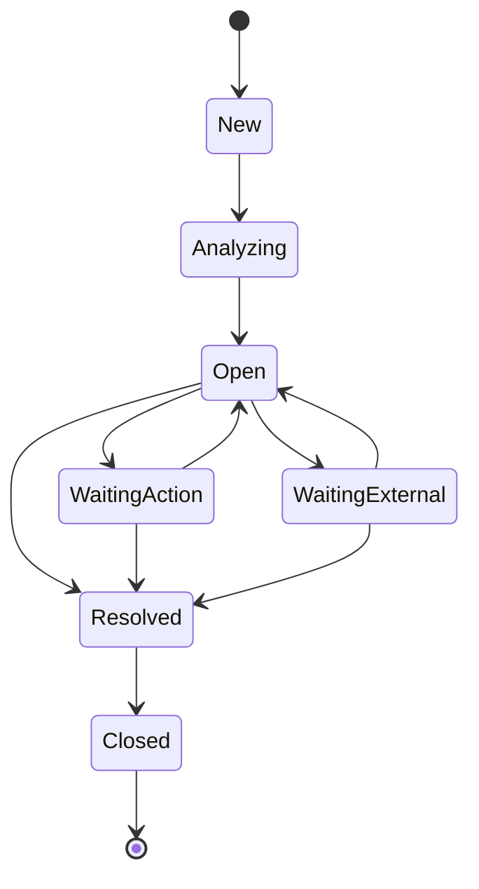

# Exception case state machine

## Aggregate boundary — PP-17

`ExceptionCase` is a tenant-scoped workflow aggregate created from a deterministic failed `MatchResult`. It stores direct references to the related invoice, purchase order, and match result, plus the exception type and UTC lifecycle timestamps. Creation rejects passed results, mismatched evaluated lines, cross-tenant inputs, and timestamps earlier than the source evaluation.

PP-17 does not create cases automatically. That orchestration belongs to PP-18. Severity, age, assignment, and queue filtering remain PP-20 scope.

## Allowed transitions

All other transitions fail without mutating the aggregate. Entering `Resolved` records `ResolvedAtUtc`; `Closed` is terminal. Arithmetic, authorization, and future resolution actions remain outside this state transition method.
