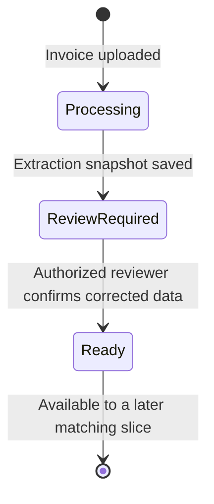

# Invoice extraction review

PP-12 and PP-13 implement the controlled boundary between provider-neutral invoice extraction and deterministic matching. An extraction never starts matching directly: its source JSON snapshot is persisted separately from reviewed values, assessed against configured critical fields, and presented to an authorized human reviewer.

## State flow

`Ready` means that invoice header and lines have been confirmed. It does not mean approved, posted, paid, or matched. A ready invoice cannot return to extraction review or be confirmed a second time.

## Confidence policy

The `InvoiceExtractionReview` configuration controls the review gate:

- `ConfidenceThreshold` is `0.8` by default.
- Critical fields are invoice number, supplier, purchase-order number, invoice date, currency, and total amount.
- A critical value is flagged when missing or when its confidence is below the threshold.
- The reviewer must explicitly acknowledge every flagged critical field before confirmation.
- Values at the threshold are accepted by the policy.

The policy is deterministic and provider-neutral. AI confidence only explains where attention is needed; it never approves a financial state transition.

## Persistence and audit

`InvoiceExtractionSnapshots` stores the tenant identifier, invoice identifier, original payload, extraction time, reviewed payload, authenticated reviewer, and review time. Original and reviewed data remain separate so a correction does not destroy source traceability.

All reads and writes use the active tenant query filters. Vendor selection is restricted to the active tenant, the invoice and reviewer use composite tenant-aware foreign keys, and the `Invoice.Review` permission protects the UI route.

## UI boundary

The review page at `/invoices/{invoiceId}/review` exposes explicit progress, field confidence, critical issues, editable invoice lines, and the human confirmation gate. The workspace dashboard is backed by tenant-scoped database queries and links recent invoices to review; it does not contain hard-coded business counts.
